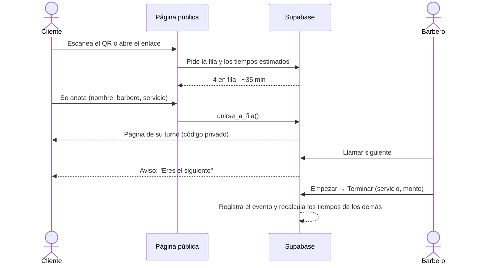
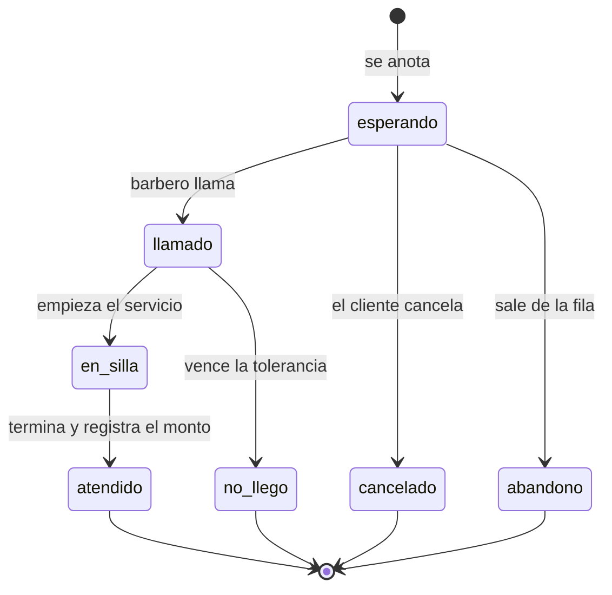
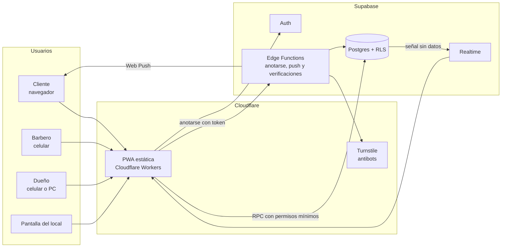

# NextCut · fila virtual para barberías

> Que ningún cliente se vaya por no saber cuánto le falta.

**Estado:** Sprints 1 y 2 terminados (base de datos, fila pública, anotarse y turno en vivo) · Sprint 3 en curso (login y panel del barbero listos; faltan TV y avisos) · Sprint 0 casi listo (falta la prueba de Web Push) · validación de campo en pausa
**Última actualización:** 26 de octubre de 2026

NextCut es un SaaS para barberías que atienden por orden de llegada. Convierte la fila física en una fila virtual: el cliente escanea un QR o abre un enlace, ve cuántas personas hay y cuánto falta, se anota desde donde esté y recibe un aviso cuando le toca. El barbero pasa los turnos desde el celular. El dueño ve, por primera vez, cuántos clientes atendió cada barbero, cuánto esperaron y cuántos se fueron sin cortarse.

NextCut ("el siguiente corte") reemplazó el 26/10/2026 al nombre provisional "Siguiente", que venía del "¡siguiente!" que se oye en toda barbería ([ADR-009](docs/decisiones.md#adr-009--nombre-del-producto-nextcut)).

---

## El problema

En la mayoría de barberías de barrio y de centro comercial el turno se maneja a ojo. El cliente llega, cuenta a los que están sentados y decide si espera o se va. Eso cuesta dinero por tres razones:

1. **El cliente decide por lo larga que se ve la fila, no por lo rápido que avanza.** En un estudio con video y datos de caja en un supermercado de Chile, cuando la fila llegaba a 15 personas o más, la probabilidad de compra bajaba de 30 % a 27 %: cerca de 10 % menos ventas ([Lu et al., *Management Science*, 2013](https://ideas.repec.org/a/inm/ormnsc/v59y2013i8p1743-1763.html)).
2. **La espera incierta pesa más que la conocida.** "Las esperas inciertas se sienten más largas que las esperas conocidas y finitas" es uno de los principios clásicos de la psicología de las filas ([Maister](https://davidmaister.com/blog/201/The-Psychology-of-Waiting-Lines.html)).
3. **El que se va no queda registrado.** El dueño ve la caja del día, pero no las ventas que perdió ni las horas en que una silla estuvo vacía mientras otra tenía cinco esperando.

**Si no se resuelve:** se pierden ventas en cada día pico sin que nadie las mida, los clientes se pasan a la barbería de al lado y el dueño decide horarios y personal sin datos.

El problema pesa más donde casi todos llegan sin cita: Zenoti estima que en las barberías de calle o de centro comercial los walk-ins son entre 70 % y 90 % de la clientela (estimación sin fuente publicada). En Honduras, además, casi ninguna barbería usa software de turnos: Fresha muestra **8 barberías en todo el país** (consultado el 25/10/2026).

La investigación completa, con la calidad de cada dato y lo que falta comprobar, está en [docs/investigacion.md](docs/investigacion.md).

### Por qué este problema y no otro

Comparamos cuatro problemas recurrentes con una matriz ponderada (frecuencia, consecuencia económica, evidencia, hueco de mercado, viabilidad y potencial SaaS):

| Problema | Puntaje (1–5) |
|---|---|
| **Fila física incierta: clientes que se van** | **4.15** |
| Control de caja y comisiones | 3.50 |
| Inasistencias a citas (no-shows) | 3.45 |
| Captación y retención de clientes | 2.85 |

La fila gana en todos los escenarios de sensibilidad. Las inasistencias ya las resuelven Booksy, Fresha y AgendaPro, y sus dos remedios (recordatorios por WhatsApp y depósitos) tienen costo variable en Honduras. El control de caja no tiene ni una cifra pública, así que no se puede elegir sin inventar. Aun así, NextCut lo cubre en parte: cada turno cerrado registra barbero, servicio y monto.

---

## La solución

### Para el cliente (sin descargar nada y sin crear cuenta)

- Escanea el QR de la puerta o abre el enlace de la bio de Instagram o del estado de WhatsApp.
- Ve cuántas personas hay en fila y el tiempo estimado con cada barbero.
- Se anota con su nombre y, si quiere, su teléfono. Elige barbero o "el primero que se libere".
- Su página de turno muestra la posición en vivo, el tiempo estimado y un aviso cuando faltan unos 15 minutos y cuando es el siguiente.
- Puede cancelar con un toque y liberar su lugar.

### Para el barbero

- Panel en el celular con cuatro botones: **Llamar siguiente · Empezar · Terminar · No llegó**.
- Al terminar registra el servicio, el monto y el método de pago (efectivo, transferencia o tarjeta).
- Puede pausarse (almuerzo) y los tiempos estimados se recalculan.

### Para el dueño

- Pantalla de la fila para una TV o tablet en el local (opcional).
- Reporte del día: clientes atendidos por barbero, ingresos registrados, espera promedio, abandonos y horas pico.
- Configuración: barberos, servicios con su duración, horario, tamaño máximo de la fila y minutos de tolerancia antes de marcar "no llegó".
- Botón para **pausar la fila remota** si el local se satura o si alguien intenta abusar.

### Flujo



### Estados de un turno



---

## Alcance del MVP (v0.1)

**Incluye:** fila virtual pública con QR, página del turno en vivo, panel del barbero, pantalla para TV, reporte del día, configuración básica y multi-barbería desde el inicio (cada barbería es un inquilino aislado).

**No incluye todavía:** citas con hora (v0.2), pagos en línea o depósitos, API de WhatsApp (v0.3), inventario, IA y apps nativas. Se dejaron fuera para lanzar rápido y con costo variable cero.

### Cómo se calcula el tiempo estimado

1. Cada servicio arranca con la duración que configura el dueño (por ejemplo, corte 30 min y corte con barba 45 min).
2. Cuando hay al menos 5 servicios reales de un barbero, se usa el promedio de sus últimos 20 servicios de ese tipo.
3. Se simula la fila en orden: cada barbero queda libre cuando termina su servicio actual (duración estimada menos el tiempo transcurrido). Cada turno se asigna a su barbero preferido o al que se libere primero.
4. Se muestra como rango redondeado a 5 minutos ("25–35 min") para no prometer precisión que no existe.
5. El reporte mide el error del estimado (diferencia promedio entre lo estimado y lo real) para ir ajustándolo.

### Notificaciones sin costo variable

Desde el 1 de octubre de 2026, Meta cobra los avisos por la API de WhatsApp en Honduras: USD 0.0113 por plantilla de utilidad, alrededor de L 0.31 por aviso ([detalle](docs/investigacion.md#3-contexto-honduras-en-octubre-de-2026)). Por eso el MVP usa tres canales gratuitos:

1. **La página del turno**, que se actualiza sola y suena y vibra cuando toca.
2. **Notificaciones push web.** En Android funcionan desde el navegador. En iPhone requieren agregar la página a la pantalla de inicio (iOS 16.4 o superior).
3. **Botón "Avisar por WhatsApp"** en el panel del barbero: abre un enlace `wa.me` con el mensaje ya escrito y se envía desde el celular de la barbería, con un toque y sin costo.

La API oficial de WhatsApp llegará como complemento pagado, con el costo de Meta trasladado y transparente ([ADR-003](docs/decisiones.md#adr-003--notificaciones-sin-api-de-whatsapp-en-el-mvp)).

---

## Métricas de éxito

| Métrica | Definición | Para qué sirve |
|---|---|---|
| **Tasa de abandono** | Turnos que salen de la fila sin ser atendidos ÷ turnos creados | Es el problema. Tiene que bajar |
| Espera real promedio | Inicio del servicio − hora en que se anotó | Experiencia del cliente |
| Error del estimado | Promedio de \|estimado − real\| | Confianza en el sistema |
| Turnos remotos | % de turnos creados fuera del local | Adopción |
| "No llegó" en turnos remotos | % de turnos remotos que no se presentan | Riesgo de abuso |
| Atendidos por barbero al día | Conteo de turnos `atendido` | Valor directo para el dueño |

**Límite honesto:** la persona que mira la fila desde la puerta y se va sin anotarse no aparece en el sistema. Ese abandono se mide en la validación de campo, contando en sitio antes y después de instalar NextCut.

---

## Arquitectura



| Capa | Elección | Por qué | Costo inicial |
|---|---|---|---|
| Frontend | React + Vite + TypeScript, como PWA | Instalable, admite Web Push y es fácil de mantener con asistentes de IA | $0 |
| Hosting | Cloudflare Workers (recursos estáticos) | Cloudflare recomienda Workers para proyectos nuevos y los estáticos son gratis. Vercel Hobby prohíbe el uso comercial ([ADR-005](docs/decisiones.md#adr-005--hosting-en-cloudflare-workers-en-lugar-de-pages)) | $0 (confirmar términos antes de cobrar) |
| Base de datos y backend | Supabase: Postgres, Auth, Realtime y Edge Functions | Tiempo real incluido y aislamiento entre barberías con RLS en la base, no solo en la interfaz | $0 hasta los límites del plan |
| Antibots | Cloudflare Turnstile | Evita que llenen la fila con turnos falsos | $0 |
| Errores | Sentry, plan gratuito | Errores del frontend sin datos personales | $0 |

Las versiones, las herramientas de desarrollo y pruebas, y el orden de construcción están en el [plan de implementación](docs/plan-implementacion.md).

**Límites del plan gratuito de Supabase** ([fuente](https://supabase.com/pricing)): 500 MB de base de datos, 200 conexiones de tiempo real simultáneas, 2 millones de mensajes de tiempo real al mes y 50,000 usuarios activos al mes. Los proyectos se pausan tras una semana sin actividad. Pro cuesta desde USD 25 al mes. Para cuidar las conexiones, la página del cliente usa tiempo real solo mientras está visible y, si no, consulta cada 20 segundos. El panel del barbero y la pantalla de TV sí usan tiempo real permanente.

Se consideró PHP + MySQL, el stack que el autor ya conoce. Se descartó para el MVP porque el tiempo real requiere un servidor de websockets o consultas constantes, y porque el aislamiento entre barberías dependería de que cada consulta filtre bien. RLS lo garantiza en la base ([ADR-002](docs/decisiones.md#adr-002--stack-supabase--cloudflare-pages)).

### Modelo de datos (primer borrador)

| Tabla | Campos clave | Nota |
|---|---|---|
| `barberias` | id, nombre, slug, zona horaria, fila_remota_activa, max_fila | Un inquilino por barbería |
| `miembros` | user_id, barberia_id, rol (`dueno`, `barbero`) | Base de los permisos |
| `barberos` | id, barberia_id, nombre, activo, en_pausa | |
| `servicios` | id, barberia_id, nombre, duracion_min, precio_ref | |
| `turnos` | id, barberia_id, codigo_publico, nombre, telefono, barbero_id, servicio_id, origen (`local` o `remoto`), estado, creado_en, llamado_en, inicio_en, fin_en, monto, metodo_pago | `codigo_publico` es aleatorio, nunca un consecutivo |
| `eventos_turno` | turno_id, actor, accion, fecha | Bitácora de auditoría |
| `suscripciones_push` | turno_id, endpoint, claves | Se borran al cerrar el turno |

---

## Seguridad

El diseño se auditó contra los 10 fallos más comunes en apps con APIs y agentes. El detalle, con amenazas, controles y pruebas, está en [docs/seguridad.md](docs/seguridad.md).

| # | Fallo | Control en NextCut |
|---|---|---|
| 1 | API keys en el código | Solo la clave publicable va al frontend. Las secretas viven en los secretos de Supabase. `gitleaks` en pre-commit y CI |
| 2 | Endpoints expuestos | RLS activo en todas las tablas. El público solo llama a 3 funciones RPC y a una vista sin teléfonos ni nombres completos; para anotarse pasa por una Edge Function con Turnstile |
| 3 | Input sin validar | Validación con zod en el cliente y otra vez en la base: largos, teléfono `+504` con 8 dígitos y servicio de la misma barbería |
| 4 | Prompt débil | No hay IA en el MVP. Reglas definidas para cuando la haya |
| 5 | Datos sensibles | Solo nombre y teléfono opcional. La pantalla pública muestra "Carlos M.", nunca el teléfono. Teléfonos borrados a los 90 días (propuesta) |
| 6 | Sin límite de tokens | Equivalente sin IA: cuotas por barbería (turnos por día, tamaño de fila y avisos por turno) |
| 7 | Permisos excesivos | El barbero solo modifica sus turnos. La pantalla de TV es de solo lectura. La clave de servicio solo existe en Edge Functions |
| 8 | Manejo de errores | Mensajes genéricos para el usuario y detalle en los logs. "Llamar siguiente" es una transacción con bloqueo para que dos barberos no llamen al mismo cliente |
| 9 | Rate limiting | Turnstile, un turno activo por teléfono, límite de turnos por IP y pausa automática de la fila remota ante picos anómalos |
| 10 | Monitoreo, logs y alertas | Tabla de eventos, Sentry, monitor de disponibilidad y alerta al dueño si entran demasiados turnos en pocos minutos |

---

## Estructura del repositorio (planificada)

```text
.
├── README.md
├── CLAUDE.md                 ← reglas para el asistente de IA (graphify)
├── docs/
│   ├── investigacion.md      ← problema, evidencia, competencia y matriz
│   ├── validacion-campo.md   ← guion de entrevistas y hoja de conteo
│   ├── plan-implementacion.md ← stack, herramientas, arquitectura y sprints
│   ├── seguridad.md          ← auditoría de los 10 fallos
│   ├── decisiones.md         ← registro de decisiones (ADR)
│   └── bitacora.md           ← registro de cambios
├── graphify-out/             ← grafo del proyecto (Graphify + Obsidian)
├── .claude/                  ← skill y hooks que mantienen el grafo al día
├── app/                      ← frontend PWA (v0.1)
├── tests/e2e/                ← pruebas de punta a punta (Playwright)
└── supabase/
    ├── migrations/           ← esquema, RLS, funciones y tareas programadas
    ├── functions/            ← Edge Functions (anotarse, avisos, invitaciones, salud)
    └── tests/                ← pruebas de RLS con pgTAP
```

La estructura completa está en el [plan de implementación](docs/plan-implementacion.md#7-estructura-del-repositorio).

## Desarrollo local

Requisitos: Node.js 24 LTS. No hace falta Docker: la app se desarrolla contra el proyecto de Supabase de pruebas en la nube ([ADR-008](docs/decisiones.md#adr-008--desarrollo-contra-supabase-en-la-nube-sin-docker-local)). La CLI de Supabase, Wrangler, Biome y Lefthook se instalan con el proyecto.

```bash
npm install
npm run dev             # app en http://localhost:5173, conectada al proyecto de pruebas
npm run check           # lint, tipos, pruebas y build (lo mismo que corre CI)
npx supabase login      # una sola vez: abre el navegador
npx supabase link --project-ref bquvluxsqfacleumlnmi
npx supabase db push    # aplica las migraciones al proyecto de pruebas
```

Las pruebas de RLS con pgTAP (un barbero de A no ve la fila de B) corren en CI, que levanta Supabase en su propio runner.

Antes de cada commit, Lefthook corre Biome y gitleaks; antes de cada push, los tipos y las pruebas.

Variables en `.env.local` (nunca se suben al repositorio; hay un `.env.example`):

```bash
VITE_SUPABASE_URL=
VITE_SUPABASE_PUBLISHABLE_KEY=   # sb_publishable_…, pública por diseño, protegida por RLS
VITE_TURNSTILE_SITE_KEY=
VITE_VAPID_PUBLIC_KEY=
VITE_SENTRY_DSN=
# Los secretos (TURNSTILE_SECRET, VAPID_PRIVATE_KEY, SMTP de Resend) van solo en los secretos de Supabase
```

---

## Modelo de negocio (hipótesis a validar)

- **Gratis:** 1 barbero, con "Hecho con NextCut" en la página pública. Cada cliente que escanea el QR ve la marca, así que el plan gratis también sirve de canal de adquisición.
- **Barbería:** tarifa plana al mes **sin cobro por barbero**. Booksy cobra USD 20 por cada barbero adicional y Fresha alrededor de USD 14.95 por miembro.
- **Precio objetivo:** menos que el valor de 2 cortes al mes. Si NextCut evita más de 2 abandonos al mes, se paga solo. El precio exacto sale de las entrevistas.
- **Complemento WhatsApp:** costo de Meta más un margen, con un tope mensual que define el dueño.

## Validación antes de programar

Antes de escribir código hay que medir lo que la investigación no pudo responder: cuántos clientes se van por la espera en barberías de El Progreso y San Pedro Sula, el ticket promedio, cómo agendan hoy y cuánto pagarían. El guion de entrevistas, la hoja de conteo para un sábado y los criterios para seguir, ajustar o descartar están en [docs/validacion-campo.md](docs/validacion-campo.md).

## Hoja de ruta

| Fase | Contenido | Condición para avanzar |
|---|---|---|
| **0 · Validación** (semanas 1–2) | 8–10 entrevistas y 3 conteos de sábado | Se cumple el criterio de la validación |
| **v0.1 · MVP** (semanas 3–6) | Fila virtual, panel del barbero, pantalla de TV y reporte del día. Piloto con 1 barbería | La barbería piloto lo usa 2 sábados seguidos |
| **v0.2** | Citas con hora dentro de la fila híbrida, recordatorios y cierre de caja con comisiones | La tasa de abandono baja frente a la línea base |
| **v0.3** | Complemento de WhatsApp, varias sucursales y reactivación de clientes inactivos | Primeras barberías pagando |

---

## Documentación y grafo

Cada cambio del proyecto se registra en [docs/bitacora.md](docs/bitacora.md) y en el grafo de conocimiento generado con Graphify (`graphify-out/`). La carpeta se abre como bóveda en Obsidian para navegar el grafo.

El grafo se actualiza solo: los hooks de git lo reconstruyen después de cada commit y, cuando cambian documentos, un hook de Claude Code pide reextraerlos al final del turno ([detalle](docs/plan-implementacion.md#5-herramientas-de-trabajo-con-ia)).

## Autor

**Gustavo Pérez** · El Progreso, Honduras · proyecto de portafolio.

Licencia: por definir.
