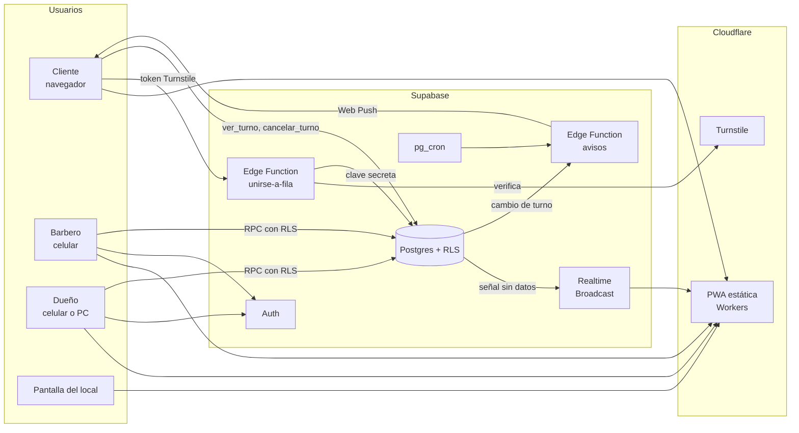
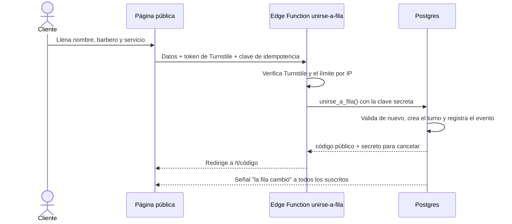

# Plan de implementación (v0.1)

**Proyecto:** [NextCut](../README.md) · **Fecha:** 26 de octubre de 2026 · **Estado:** propuesto
**Relacionado:** [Decisiones](decisiones.md) · [Seguridad](seguridad.md) · [Validación de campo](validacion-campo.md) · [Bitácora](bitacora.md)

Este es el plan principal para pasar del diseño al MVP. Define el stack con sus versiones, las herramientas de trabajo, la arquitectura detallada, el orden de construcción por semanas y las pruebas que tiene que pasar cada parte antes del piloto.

---

## 1. Resumen

- **Qué se construye:** la v0.1 del [README](../README.md#alcance-del-mvp-v01): fila pública con QR, página del turno en vivo, panel del barbero, pantalla de TV, reporte del día, configuración y multi-barbería desde el inicio.
- **Con qué:** React + Vite + TypeScript como PWA, servida desde **Cloudflare Workers**, con Supabase de backend (Postgres con RLS, Auth, Realtime y Edge Functions). Todo en planes gratuitos.
- **En cuánto tiempo:** 4 semanas de construcción (semanas 3 a 6 de la hoja de ruta) y 2 sábados de piloto.
- **Condición para empezar:** que la [validación de campo](validacion-campo.md#4-criterios-de-decisión-propuestos) dé **Seguir**. Lo único que se adelanta es el Sprint 0 (entorno y pruebas de riesgo), porque sirve igual si el resultado es "ajustar".

## 2. Calendario

| Semana | Fechas (tentativas) | Fase | Entregable |
|---|---|---|---|
| 1–2 | 26 oct – 8 nov | **0 · Validación** + Sprint 0 en paralelo | Resultado de campo · entorno listo y riesgos técnicos despejados |
| 3 | 9 – 15 nov | Sprint 1 · Base de datos y seguridad | Esquema, RLS y funciones con pruebas pgTAP en verde |
| 4 | 16 – 22 nov | Sprint 2 · Cliente | Fila pública, formulario y página del turno en vivo |
| 5 | 23 – 29 nov | Sprint 3 · Barbero, TV y avisos | Panel del barbero, pantalla de TV y Web Push |
| 6 | 30 nov – 6 dic | Sprint 4 · Dueño y lanzamiento | Configuración, reporte, antiabuso y producción |
| 7–8 | 7 – 20 dic | **Piloto** | 2 sábados seguidos en 1 barbería (12 y 19 de diciembre) |

Diciembre es temporada alta (hipótesis de la [investigación](investigacion.md#7-problema-elegido)): el piloto mide el problema en su peor momento, pero la barbería tendrá menos paciencia para una herramienta nueva. Por eso la sección 13 define qué recortar si la construcción se atrasa.

---

## 3. Stack

Versiones vigentes al 26/10/2026 (consultadas en npm). Las exactas quedan fijadas en `package-lock.json`.

| Capa | Elección | Versión | Por qué |
|---|---|---|---|
| Lenguaje | TypeScript | 7.0 | El compilador nativo es unas 10 veces más rápido. Su única carencia (no tiene API para otras herramientas) no afecta porque el lint lo hace Biome |
| Interfaz | React | 19.3 | Lo que conocen mejor los asistentes de IA; React escapa el texto por defecto (fallo 3) |
| Build | Vite | 8.3 | Servidor de desarrollo instantáneo y build estático |
| Estilos | Tailwind CSS (plugin de Vite) | 4.3 | Estilos en el mismo componente, sin hojas de estilo que mantener |
| Componentes | shadcn/ui | — | Componentes accesibles copiados al repo; solo los que se usen |
| Rutas | React Router (modo SPA) | 8.5 | El router más documentado; carga perezosa por ruta |
| Datos del servidor | TanStack Query | 5 | Caché, reintentos y recarga cuando llega la señal de tiempo real |
| Formularios y validación | react-hook-form + zod | 7 · 4.6 | El mismo esquema zod valida en el cliente y documenta lo que la base vuelve a validar |
| PWA y Web Push | Service worker propio y cifrado con WebCrypto | — | `app/public/sw.js` sin caché y `_shared/webpush.ts` sin dependencias ([ADR-014](decisiones.md#adr-014--avisos-por-web-push-sin-librerías-ni-caché); reemplaza a vite-plugin-pwa) |
| Cliente de Supabase | @supabase/supabase-js | 2.118 | Auth, RPC y Realtime |
| Base de datos | Supabase Postgres + RLS | — | Aislamiento entre barberías en la base, no en la interfaz |
| Lógica del servidor | Supabase Edge Functions (Deno) | — | Turnstile, Web Push e invitaciones con la clave secreta fuera del navegador |
| Tareas programadas | pg_cron + pg_net (Supabase) | — | Vencer la tolerancia, revisar avisos y borrar teléfonos viejos |
| Hosting | Cloudflare Workers (recursos estáticos) | Wrangler 4 | Cloudflare recomienda Workers para proyectos nuevos ([ADR-005](decisiones.md#adr-005--hosting-en-cloudflare-workers-en-lugar-de-pages)) |
| Antibots | Cloudflare Turnstile | — | Gratis y sin rompecabezas para el cliente |
| Correo de Auth | Resend (SMTP) | — | El SMTP incluido en Supabase solo manda unos pocos correos por hora; Resend da 3,000 al mes gratis |
| Errores | Sentry (React) | 11 | Errores del frontend sin datos personales |
| Fechas y horas | API `Intl` del navegador | — | Zona `America/Tegucigalpa` sin librerías extra |
| QR | qrcode.react | 4.2 | QR imprimible desde el panel del dueño |

**Lo que cambia respecto a [ADR-002](decisiones.md#adr-002--stack-supabase--cloudflare-pages):**

1. **Workers en lugar de Pages.** La documentación de Cloudflare Pages ahora dice "Start new projects with Workers". Pages sigue funcionando, pero las funciones nuevas llegan a Workers. Para una SPA estática el cambio cuesta un archivo `wrangler.jsonc`.
2. **Claves nuevas de Supabase desde el día uno.** Supabase retira las claves `anon` y `service_role` a finales de 2026 ([documentación](https://supabase.com/docs/guides/api/api-keys)). El proyecto usa la clave publicable (`sb_publishable_…`) en el frontend y la secreta (`sb_secret_…`) solo en Edge Functions.

## 4. Herramientas de desarrollo

| Para qué | Herramienta | Dónde corre | Nota |
|---|---|---|---|
| Paquetes | npm | Local y CI | Ya instalado (Node 24 LTS, npm 11). Un solo `package.json` en la raíz |
| Lint y formato | Biome 2.6 | Editor, pre-commit y CI | Reemplaza ESLint + Prettier en una herramienta. No depende de la API de TypeScript |
| Tipos | `tsc --noEmit` (TypeScript 7) | Pre-push y CI | Tipos de la base generados con `supabase gen types` |
| Pruebas unitarias | Vitest 5 + Testing Library | Local y CI | Cálculo del tiempo estimado, esquemas zod y componentes |
| Pruebas de la base | pgTAP con `supabase test db` | CI | RLS, permisos y funciones ([seguridad](seguridad.md)) |
| Pruebas de punta a punta | Playwright 1.64 + axe | CI | Flujos completos en viewport de celular y accesibilidad |
| Base de desarrollo | Proyecto `siguiente-pruebas` + Supabase CLI 2.122 | Nube | Sin Docker local ([ADR-008](decisiones.md#adr-008--desarrollo-contra-supabase-en-la-nube-sin-docker-local)): `db push --linked`, `gen types` y `functions deploy --use-api` |
| Hooks de git | Lefthook 2 | Local | Biome y gitleaks antes de cada commit. Convive con los hooks de graphify (ver sección 5) |
| Secretos | gitleaks | Pre-commit y CI | Fallo 1: ninguna clave entra al repositorio |
| CI/CD | GitHub Actions | GitHub | Pruebas en cada PR; despliegue al fusionar en `main` |
| Despliegue del frontend | Wrangler 4 | CI | URL de vista previa por PR con `wrangler versions upload` |
| Disponibilidad | UptimeRobot (plan gratis) | Nube | Consulta el endpoint de salud cada 5 minutos |
| Analítica de visitas | Cloudflare Web Analytics | Nube | Sin cookies; cuenta escaneos del QR. Las métricas del producto salen de la base |

**Por instalar en la máquina de desarrollo:** gitleaks y, opcionalmente, la CLI de GitHub (`gh`). Docker no hace falta ([ADR-008](decisiones.md#adr-008--desarrollo-contra-supabase-en-la-nube-sin-docker-local)). La CLI de Supabase y Wrangler se instalan como dependencias del proyecto, sin instalación global.

## 5. Herramientas de trabajo con IA

| Herramienta | Uso en este proyecto |
|---|---|
| **graphify** (instalado) | Grafo de conocimiento del proyecto en `graphify-out/`. Se actualiza solo: los hooks de git reconstruyen el código tras cada commit, y un hook de Claude Code pide reextraer los documentos al final de cada turno en que cambien (`.claude/hooks/graphify_sync.py`; se apaga con `GRAPHIFY_AUTO_SYNC=0`). Antes de buscar en el código, se consulta con `graphify query` |
| **Supabase MCP** (conectado) | Revisar el Security Advisor, los logs y los tipos del proyecto remoto. Las migraciones **siempre** se escriben como archivos en `supabase/migrations/` y se aplican con la CLI, nunca a mano en producción |
| **Supabase agent skills** | Guía de buenas prácticas de RLS y funciones para el asistente (`npx skills add supabase/agent-skills`, en el Sprint 0) |
| **Navegador integrado** | Revisar cada pantalla en tamaño de celular (375 px) y la TV en horizontal antes de cerrar una tarea |

Si en algún momento se reinstalan los hooks de git (por ejemplo, al configurar Lefthook), hay que correr `graphify hook install` y comprobar con `graphify hook status` que siguen los cuatro hooks de graphify.

---

## 6. Arquitectura detallada



### Anotarse en la fila



### Decisiones de diseño de esta arquitectura

1. **Anotarse pasa por una Edge Function** ([ADR-007](decisiones.md#adr-007--anotarse-pasa-por-una-edge-function-y-el-tiempo-real-solo-manda-señales)). Si el público pudiera llamar `unirse_a_fila` directo, cualquiera se saltaría Turnstile llamando a la API. La función solo la ejecuta la clave secreta, desde la Edge Function, después de verificar Turnstile y el límite por IP.
2. **El tiempo real solo manda señales.** Un trigger publica en el canal `fila:<barberia_id>` un mensaje vacío ("la fila cambió") con Broadcast. Cada pantalla vuelve a pedir sus datos con sus propios permisos. Así ningún teléfono ni nombre completo viaja por un canal público.
3. **El estimado se calcula con un solo módulo.** `supabase/functions/_shared/eta.ts` es TypeScript puro, sin dependencias. Lo usan la página del cliente (para mostrar el rango) y la Edge Function `avisos` (para decidir cuándo faltan 15 minutos). Se prueba con Vitest.
4. **Los avisos se revisan por evento y por reloj.** Cada cambio de turno dispara `avisos` vía `pg_net`, y `pg_cron` la llama cada minuto en horario de atención, porque el tiempo avanza aunque nadie toque nada. Máximo 2 avisos por turno (fallo 6).
5. **La pantalla de TV no necesita token.** Muestra solo la vista pública, que ya no tiene teléfonos ni nombres completos. Quitar el token elimina un secreto que gestionar sin perder protección.
6. **Ahorro de conexiones.** La página del cliente usa Realtime solo mientras está visible y si no consulta cada 20 segundos. El panel del barbero y la TV quedan conectados (límite gratuito: 200 conexiones simultáneas).

## 7. Estructura del repositorio

```text
.
├── README.md
├── CLAUDE.md                     ← reglas para el asistente (graphify)
├── package.json                  ← un solo paquete: app, pruebas y scripts
├── biome.json · lefthook.yml · wrangler.jsonc · tsconfig.json
├── .env.example                  ← variables públicas, sin valores
├── .github/workflows/            ← ci.yml (PR) y deploy.yml (main)
├── .claude/                      ← skill y hooks de graphify
├── docs/                         ← investigación, decisiones, seguridad, plan y bitácora
├── graphify-out/                 ← grafo del proyecto (se actualiza solo)
├── app/
│   ├── index.html
│   ├── public/                   ← íconos y manifest de la PWA
│   └── src/
│       ├── main.tsx · router.tsx · sw.ts (service worker)
│       ├── lib/                  ← cliente de Supabase, tipos generados, esquemas zod
│       ├── components/           ← componentes compartidos (shadcn/ui)
│       └── features/
│           ├── fila/             ← página pública, formulario y turno en vivo
│           ├── barbero/          ← panel de los cuatro botones
│           ├── pantalla/         ← vista para TV
│           └── dueno/            ← configuración, QR y reporte del día
├── supabase/
│   ├── config.toml
│   ├── migrations/               ← esquema, RLS, funciones, triggers y cron
│   ├── seed.sql                  ← 2 barberías de prueba para probar el aislamiento
│   ├── functions/
│   │   ├── _shared/              ← eta.ts, validaciones y respuestas de error
│   │   ├── unirse-a-fila/
│   │   ├── avisos/
│   │   ├── invitar-barbero/
│   │   └── salud/
│   └── tests/                    ← pruebas pgTAP
├── tests/e2e/                    ← Playwright
└── scripts/                      ← prueba de carga y de concurrencia
```

## 8. Funciones de la base y quién las ejecuta

Todas son `security definer` con `search_path` fijo, `revoke all ... from public` y `execute` concedido solo al rol que aparece aquí ([fallo 7](seguridad.md#7-permisos-excesivos--)).

| Función o vista | Quién | Qué hace |
|---|---|---|
| vista `fila_publica` | Público | Turnos en espera: número visible, "Carlos M.", barbero y servicio. Sin teléfonos |
| `ver_turno(codigo)` | Público | Posición, estado y datos para calcular el estimado de un turno |
| `cancelar_turno(codigo, secreto)` | Público | Cancela el turno propio |
| `suscribir_push(codigo, secreto, suscripcion)` | Público | Guarda la suscripción de Web Push de ese turno |
| `unirse_a_fila(...)` | Solo clave secreta | La llama la Edge Function después de Turnstile |
| `llamar_siguiente(barbero_id)` | Barbero de esa barbería | Transacción con `FOR UPDATE SKIP LOCKED` |
| `empezar_turno`, `terminar_turno`, `marcar_no_llego` | Barbero dueño del turno | Cambian el estado y registran el evento |
| `pausar_barbero(en_pausa)` | El propio barbero | Recalcula los estimados |
| `pausar_fila_remota`, `renombrar_turno`, `reporte_dia(fecha)` | Dueño | Control del local y reporte |
| `vencer_tolerancia()`, `cerrar_dia()`, `borrar_telefonos_viejos()` | pg_cron | "No llegó" automático, abandonos al cierre y borrado a los 90 días |
| `avisos_pendientes(clave)`, `reservar_aviso`, `liberar_aviso`, `borrar_suscripcion` | Solo clave secreta | Los usa la Edge Function `avisos`; `avisos_pendientes` valida la clave de Vault ([ADR-014](decisiones.md#adr-014--avisos-por-web-push-sin-librerías-ni-caché)) |
| `privado.revisar_avisos()` y trigger `turnos_avisos` | pg_cron y la base | Llaman a la función `avisos` con pg_net solo si hay un aviso pendiente |

Las tablas de configuración (`barberias`, `barberos`, `servicios`) se editan directo con políticas RLS que solo dejan pasar al dueño de esa barbería.

---

## 9. Sprints

Cada sprint termina con su criterio de salida en verde. Si no se cumple, no se empieza el siguiente.

### Sprint 0 · Entorno y pruebas de riesgo (semanas 1–2, en paralelo a la validación)

No construye funciones del producto. Prepara el entorno y prueba lo que podría obligar a cambiar el diseño.

- [ ] Instalar gitleaks y crear el repositorio en GitHub.
- [x] Crear el proyecto Vite (React + TypeScript 7 + Tailwind 4) con Biome, Vitest y Lefthook.
- [x] `supabase init`, crear el proyecto `siguiente-pruebas` en la nube y generar tipos desde él ([ADR-008](decisiones.md#adr-008--desarrollo-contra-supabase-en-la-nube-sin-docker-local)).
- [x] CI mínimo: Biome, `tsc`, Vitest, gitleaks y build.
- [ ] Crear el proyecto de producción y el Worker en Cloudflare con `workers.dev`, y desactivar las claves heredadas (`anon` y `service_role`) en ambos proyectos.
- [x] **Prueba de riesgo 1 · Broadcast público:** superada el 26/10/2026. Una señal enviada con `realtime.send(..., private => false)` llega a un cliente anónimo con la clave publicable, y ese cliente es rechazado en un canal privado (`scripts/spikes/broadcast-publico.mjs`).
- [ ] **Prueba de riesgo 2 · Web Push:** una Edge Function envía un aviso con VAPID que llega a Chrome en Android y a un iPhone con la página agregada a la pantalla de inicio. Avance del 31/10/2026: el cifrado reproduce el ejemplo de la RFC 8291 y la función `avisos` está desplegada; falta probarlo en teléfonos reales.
- [x] **Prueba de riesgo 3 · Turnstile + IP:** superada el 28/10/2026. La Edge Function desplegada verifica el token con Cloudflare y recibe la IP real en `cf-connecting-ip` y `x-real-ip`, aunque el cliente mande otra; Cloudflare bloquea a quien intenta mandar `cf-connecting-ip` por su cuenta. `x-forwarded-for` se descartó porque el cliente puede escribirlo ([ADR-013](decisiones.md#adr-013--detalles-de-anotarse-en-la-fila)).

**Salida:** CI en verde con un "hola mundo" desplegado, y las 3 pruebas de riesgo con resultado documentado en la bitácora. Si alguna falla, se registra un ADR con la alternativa antes del Sprint 1.

### Sprint 1 · Base de datos y seguridad (semana 3)

- [x] Migraciones: tablas del [modelo de datos](../README.md#modelo-de-datos-primer-borrador), `CHECK` en columnas (nombre 2–40, teléfono `^\+504[0-9]{8}$`, montos ≥ 0) y RLS con denegación por defecto.
- [x] Funciones de la sección 8, con validación dentro de cada una.
- [x] `eventos_turno` de solo inserción, alimentada por triggers en cada cambio de estado.
- [x] Trigger de señal de Broadcast y contador de turnos por IP.
- [x] `seed.sql` con 2 barberías, 3 barberos y servicios.
- [x] Pruebas pgTAP: el público no lee `turnos`; la barbería A no ve ni toca la B; un barbero no cierra el turno de otro ni edita uno `atendido`; `fila_publica` y `ver_turno` no devuelven teléfonos.
- [x] Script de concurrencia: dos barberos llaman al siguiente a la vez y cada uno recibe un cliente distinto.

**Salida:** `supabase test db` y el script de concurrencia en verde en CI. Fallos 2, 7 y 8 pasan a 🟩 en [seguridad](seguridad.md).

**Resultado:** salida cumplida el 27/10/2026 en la [corrida #5 del CI](https://github.com/gustavoapz07/NextCut/actions/runs/40522147570).

### Sprint 2 · Cliente: fila pública y turno en vivo (semana 4)

- [x] `eta.ts` con pruebas: duración configurada, promedio de los últimos 20 servicios cuando hay 5 o más, simulación por barbero, pausa y rango redondeado a 5 minutos ([ADR-012](decisiones.md#adr-012--cómo-se-calcula-el-estimado-de-espera)).
- [x] Página `/b/:slug`: personas en fila y estimado por barbero, al día con la señal de tiempo real. Falta que `fila_publica` mande las duraciones recientes.
- [x] Formulario con zod, Turnstile y clave de idempotencia; aviso de privacidad corto.
- [x] Edge Function `unirse-a-fila` con mensajes de error genéricos y código corto ([ADR-013](decisiones.md#adr-013--detalles-de-anotarse-en-la-fila)).
- [x] Página `/t/:codigo`: posición y estimado en vivo (señal + recarga, o consulta cada 20 s si está oculta), sonido y vibración cuando toca, botón de cancelar.
- [x] El QR de la puerta lleva `?origen=qr` para distinguir turnos locales de remotos: la página pública lo pasa al formulario y el turno queda como `local`.

**Salida:** Playwright: un cliente se anota en un celular simulado y ve su posición cambiar cuando otro turno avanza. Las pruebas del fallo 3 (nombres de 500 caracteres, `<script>`, emojis, teléfonos de otros países, servicio de otra barbería) pasan.

**Resultado:** salida cumplida el 28/10/2026 con `npm run test:e2e` (`tests/e2e/fila.spec.ts`) contra `siguiente-pruebas`. Falta correrla en el CI: en la laptop no hay Docker para Supabase local ([ADR-008](decisiones.md#adr-008--desarrollo-contra-supabase-en-la-nube-sin-docker-local)).

### Sprint 3 · Barbero, TV y avisos (semana 5)

- [x] Login con correo y contraseña (Supabase Auth). Falta el SMTP de Resend, que hace falta para recuperar la contraseña y para las invitaciones del Sprint 4.
- [x] Panel del barbero: **Llamar siguiente · Empezar · Terminar · No llegó**, registro de servicio, monto y método de pago, y pausa.
- [x] Botón "Avisar por WhatsApp": enlace `wa.me` con el mensaje ya escrito.
- [x] Pantalla `/b/:slug/tv`: fila en letra grande, conexión permanente y pantalla siempre encendida (Wake Lock).
- [x] Web Push: suscripción desde la página del turno, service worker y Edge Function `avisos` (por evento con `pg_net` y cada minuto con `pg_cron`), máximo 2 avisos por turno ([ADR-014](decisiones.md#adr-014--avisos-por-web-push-sin-librerías-ni-caché)). Falta cargar las claves (Vault y VAPID) y probarlo en teléfonos.
- [x] `vencer_tolerancia()` cada minuto con `pg_cron` (migración `20261029012938_tareas_programadas`).

**Salida:** Playwright: el barbero llama, empieza y termina un turno y el cliente lo ve en su página. Prueba manual de push en Android y iPhone. Un barbero no ve los turnos de otra barbería desde la interfaz.

**Avance (31/10/2026):** las seis tareas están hechas. De la salida pasa la primera parte: `tests/e2e/barbero.spec.ts` (el barbero llama, empieza y termina y el cliente lo ve). Falta la prueba manual de push en Android y iPhone, que necesita las claves cargadas y la app en HTTPS.

### Sprint 4 · Dueño, antiabuso y lanzamiento (semana 6)

- [ ] Configuración: barberos (con invitación por correo), servicios con duración, horario, tamaño máximo de la fila y tolerancia.
- [ ] QR imprimible y botón para pausar la fila remota; renombrar u ocultar un turno.
- [ ] Reporte del día: atendidos por barbero, ingresos registrados, espera promedio, error del estimado, abandonos y horas pico.
- [ ] Antiabuso: un turno activo por teléfono, 5 turnos por IP cada 10 minutos, pausa automática ante picos y alerta al dueño.
- [ ] `cerrar_dia()` y `borrar_telefonos_viejos()` con `pg_cron`.
- [ ] Sentry sin datos personales, endpoint `salud` y monitor de UptimeRobot.
- [ ] Prueba de carga: 50 intentos en un minuto; pasan como máximo los permitidos y salta la alerta.
- [ ] Revisión del Security Advisor de Supabase y búsqueda de `sb_secret` en el build de producción.
- [ ] Despliegue a producción y carga de la barbería piloto.

**Salida:** los 10 fallos de [seguridad](seguridad.md) en 🟩 o ⬜, la lista de pendientes antes del piloto completa y la barbería piloto configurada con su QR impreso.

### Piloto (semanas 7–8)

- Instalación presencial antes del primer sábado; el QR en la puerta y en la bio de Instagram.
- Conteo en sitio con la [hoja de observación](validacion-campo.md#3-hoja-de-observación-sábado) para comparar el abandono con la línea base.
- Revisión diaria de errores, alertas y métricas de éxito; cada hallazgo a la bitácora.
- **Condición para pasar a la v0.2:** la barbería usa NextCut 2 sábados seguidos ([hoja de ruta](../README.md#hoja-de-ruta)).

---

## 10. Pruebas

| Tipo | Herramienta | Qué cubre | Cuándo corre |
|---|---|---|---|
| Unitarias | Vitest | Estimado, esquemas zod, componentes | Cada push y PR |
| Base de datos | pgTAP | RLS, permisos, validaciones y estados | Cada PR (Supabase local en CI) |
| Concurrencia | Script con dos conexiones | "Llamar siguiente" simultáneo, doble envío del formulario | Cada PR |
| Punta a punta | Playwright + axe | Cliente, barbero, TV y dueño en viewport de celular; accesibilidad | Cada PR |
| Secretos | gitleaks | Claves en el código o el historial | Pre-commit y cada PR |
| Carga y abuso | Script de 50 turnos por minuto | Límites, pausa automática y alerta | Antes del piloto |
| Manual | Celulares reales | Push en Android e iPhone, sonido, vibración y QR impreso | Antes del piloto |

## 11. Integración y despliegue

| Entorno | Frontend | Backend | Para qué |
|---|---|---|---|
| Local | `vite` | Proyecto de Supabase de pruebas (en la nube, sin Docker) | Desarrollo |
| CI | — | `supabase start` en el runner de GitHub | Pruebas pgTAP aisladas en cada PR |
| Vista previa | URL por PR (`wrangler versions upload`) | Proyecto de Supabase de pruebas | Revisar cambios en el celular sin tocar datos reales |
| Producción | `wrangler deploy` al fusionar en `main` | Proyecto de Supabase | Piloto |

- **CI (cada PR):** Biome → `tsc` → Vitest → Supabase local + pgTAP → script de concurrencia → Playwright → gitleaks → build.
- **Migraciones:** durante el MVP se aplican a producción a mano con `supabase db push`, después de que CI pase. Automatizarlo queda para la v0.2.
- **Secretos:** `TURNSTILE_SECRET`, `VAPID_PRIVATE_KEY` y la configuración de Resend viven en los secretos de Supabase. En GitHub solo van `CLOUDFLARE_API_TOKEN` y `SUPABASE_ACCESS_TOKEN`.
- **Variables públicas** (`.env.local`, con `.env.example` en el repo): `VITE_SUPABASE_URL`, `VITE_SUPABASE_PUBLISHABLE_KEY`, `VITE_TURNSTILE_SITE_KEY`, `VITE_VAPID_PUBLIC_KEY` y `VITE_SENTRY_DSN`.

## 12. Definición de terminado

Una tarea está terminada cuando:

1. Tiene pruebas y pasan en CI.
2. Si toca un control de [seguridad](seguridad.md), su estado se actualizó.
3. Se revisó en el navegador en tamaño de celular.
4. No agrega costo variable sin un ADR que lo justifique.
5. Tiene su entrada en la [bitácora](bitacora.md); el grafo se actualiza solo.

## 13. Riesgos técnicos

| Riesgo | Probabilidad | Mitigación |
|---|---|---|
| El Broadcast público no llega a clientes sin sesión | Resuelto | La prueba de riesgo 1 confirmó que llega (26/10/2026) |
| Un `db reset` borra el proyecto de pruebas, que comparten el desarrollo y las vistas previas | Media | Es solo de pruebas y `seed.sql` lo reconstruye; producción va en otro proyecto |
| Web Push no funciona en iPhone sin instalar la PWA | Alta (conocido) | La página en vivo y el botón `wa.me` son el canal principal; el push es un extra |
| Se superan las 200 conexiones de tiempo real | Baja en el piloto | Realtime solo en pantalla visible; alerta en el panel de Supabase |
| El proyecto gratuito se pausa tras una semana sin actividad | Media fuera del piloto | El monitor de disponibilidad consulta la base a diario (verificar que cuenta como actividad) |
| Herramientas que necesitan la API de TypeScript 7 | Baja | Alias de `typescript` a `@typescript/typescript6` solo para esa herramienta |
| La construcción se atrasa | Media | Recortes de la tabla siguiente |
| Los QR impresos apuntan a un dominio que después cambia | Media | Fijar el dominio definitivo antes de imprimir el QR del piloto |

**Recortes si no alcanza el tiempo** (en este orden):

1. Pantalla de TV → la barbería usa la página pública en una tablet.
2. Web Push → quedan la página en vivo y el botón `wa.me`.
3. Invitación por correo → el dueño crea la cuenta del barbero.
4. Gráfica de horas pico → el reporte muestra solo la tabla.

Nunca se recortan las pruebas de RLS, Turnstile ni los límites por IP.

## 14. Costos

| Servicio | Plan | Límite que importa | Costo |
|---|---|---|---|
| Supabase | Free | 2 proyectos, 500 MB, 200 conexiones de tiempo real, 2 M mensajes y 500,000 invocaciones de Edge Functions al mes | $0 (Pro desde USD 25 al mes) |
| Cloudflare Workers + Turnstile + Web Analytics | Free | Los recursos estáticos no cuentan como solicitudes cobradas | $0 |
| Resend | Free | 3,000 correos al mes | $0 |
| Sentry | Developer | 5,000 errores al mes | $0 |
| UptimeRobot | Free | 50 monitores cada 5 minutos | $0 |
| GitHub Actions | Free | Público: minutos ilimitados · privado: 2,000 al mes | $0 |
| Dominio propio | Opcional | — | Unos USD 10 al año |

Fuentes: [Supabase Pricing](https://supabase.com/pricing), [Cloudflare: migrar de Pages a Workers](https://developers.cloudflare.com/workers/static-assets/migration-guides/migrate-from-pages/), [Supabase API keys](https://supabase.com/docs/guides/api/api-keys), [Broadcast de Supabase](https://supabase.com/docs/guides/realtime/broadcast), [Edge Functions programadas](https://supabase.com/docs/guides/functions/schedule-functions). Consultadas el 26/10/2026. Los límites de Resend, Sentry y UptimeRobot hay que confirmarlos al crear cada cuenta.

## 15. Decisiones pendientes

- [ ] **Resultado de la validación de campo:** confirma o cambia el alcance de los sprints 2 a 4.
- [ ] **Dominio:** `workers.dev` gratis o dominio propio, antes de imprimir el QR del piloto.
- [ ] **Espacio para producción:** la cuenta de Supabase ya usa sus 2 proyectos gratuitos (`siguiente-pruebas` y `cms-opalo`). Antes del piloto hay que pausar otro proyecto o pagar Pro.
- [ ] **Plazo de borrado de teléfonos:** 90 días propuestos, a confirmar con los dueños ([fallo 5](seguridad.md#5-datos-sensibles--)).
- [x] **Repositorio público o privado:** público, en [gustavoapz07/NextCut](https://github.com/gustavoapz07/NextCut), con los commits firmados con el correo privado de GitHub.
- [ ] **Disponibilidad del nombre NextCut:** revisar dominio y marca antes de imprimir material ([ADR-009](decisiones.md#adr-009--nombre-del-producto-nextcut)).
- [ ] **Términos de uso comercial** de los planes gratuitos de Cloudflare y Supabase, antes de cobrar.
